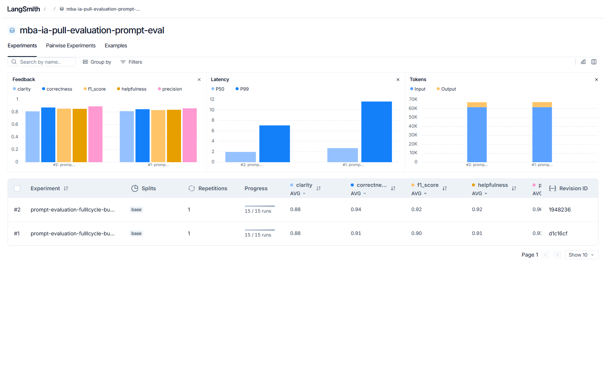
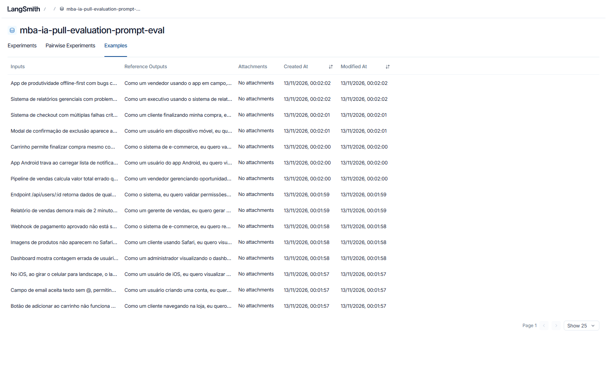
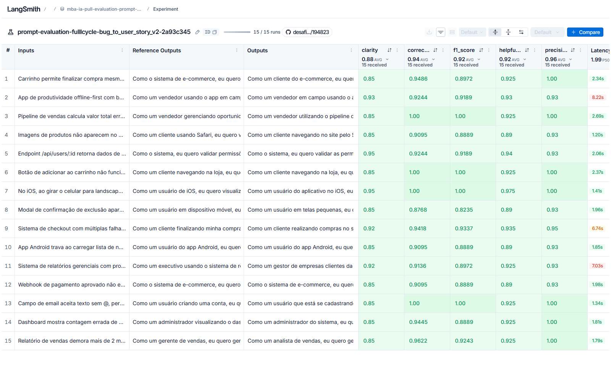
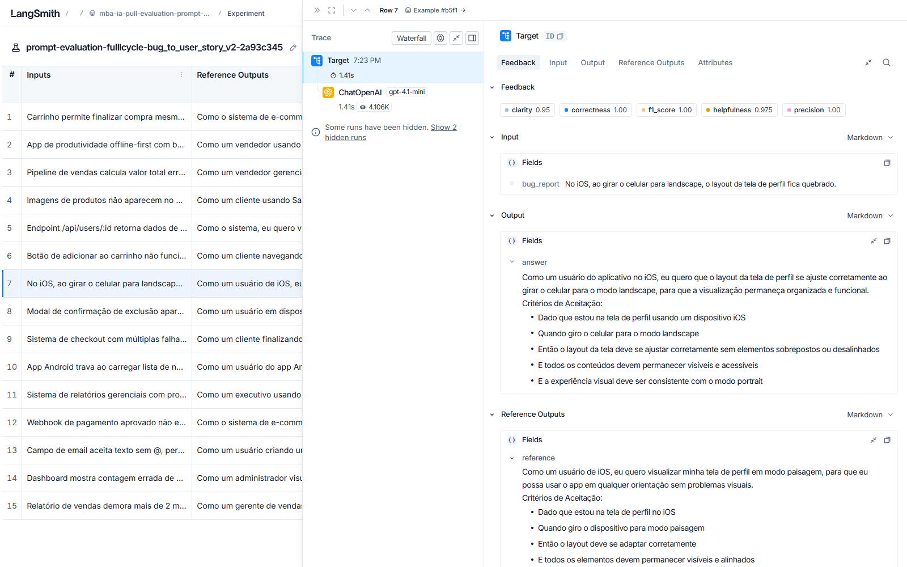
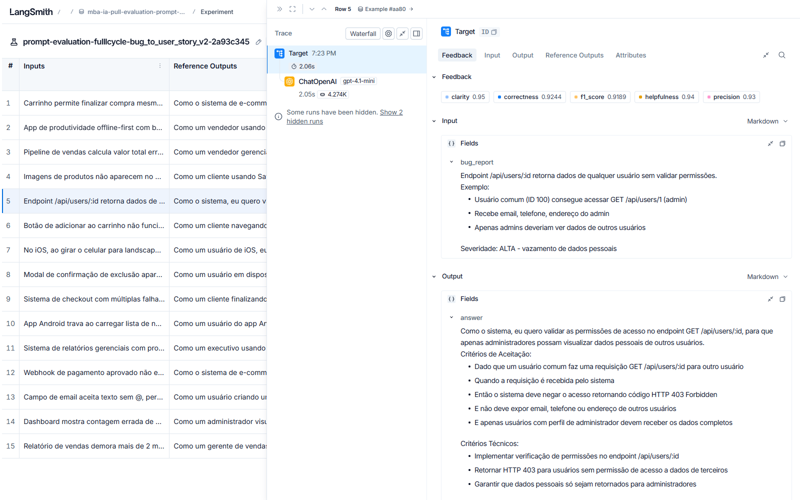
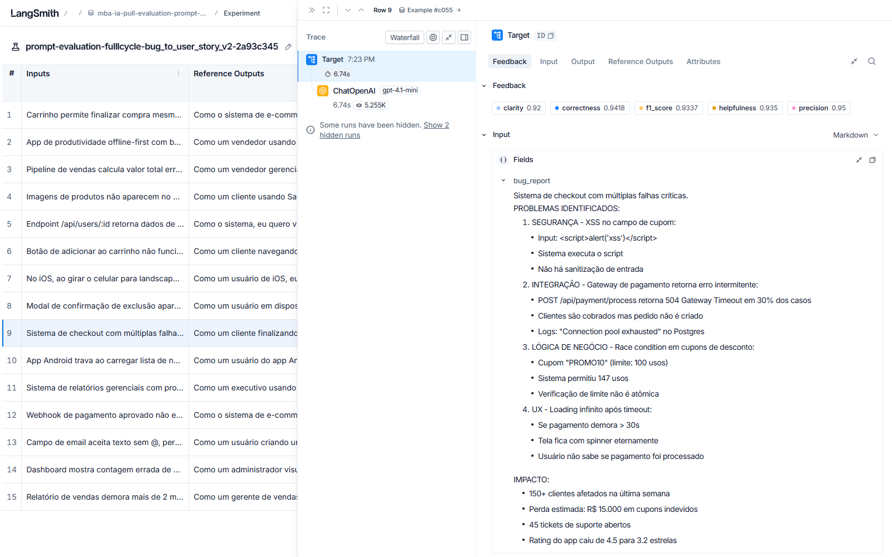

# Pull, Otimização e Avaliação de Prompts com LangChain e LangSmith

Desafio do módulo de Prompt Engineering do MBA em Engenharia de Software com IA (Full Cycle).

O projeto baixa um prompt de baixa qualidade do LangSmith Prompt Hub, publica uma versão otimizada e mede o resultado com cinco métricas. O prompt converte um relato de bug em uma User Story com critérios de aceitação.

## Técnicas Aplicadas (Fase 2)

O prompt otimizado está em `prompts/bug_to_user_story_v2.yml`.

### Few-shot Learning

O avaliador compara a resposta com uma User Story de referência, e o formato esperado muda conforme o tamanho do bug. Mostrar exemplos é mais eficaz do que descrever esse formato.

O prompt traz quatro exemplos de entrada e saída: um bug simples, dois médios e um complexo. Os exemplos foram escritos para este trabalho e não vêm do dataset de avaliação.

```text
Relato de bug:
Botão de logout não faz nada quando clico nele no menu do usuário.

User Story:
Como um usuário autenticado, eu quero encerrar minha sessão pelo botão de logout,
para que minha conta fique protegida quando eu terminar de usar o sistema.

Critérios de Aceitação:
- Dado que estou autenticado no sistema
- Quando clico no botão de logout no menu do usuário
- Então minha sessão deve ser encerrada
- E devo ser redirecionado para a tela de login
- E não devo conseguir acessar páginas restritas sem autenticar novamente
```

### Role Prompting

O prompt original usava "um assistente". Escrever User Story é trabalho de produto, então a persona passou a ser um Product Manager com base técnica, o que direciona a resposta para usuário, valor e critérios testáveis.

```text
Você é um Product Manager sênior com mais de 10 anos de experiência em times ágeis
de produtos digitais (web, mobile, SaaS e e-commerce) e sólida base técnica.
```

### Chain of Thought

Converter um bug em User Story envolve uma sequência de decisões. O prompt lista seis passos que o modelo segue antes de escrever: quem é afetado, o que essa pessoa quer, qual é o benefício, quais fatos do relato precisam ser preservados, qual é a complexidade e, por fim, a escrita.

O raciocínio não aparece na resposta, porque texto extra reduz as notas de Clarity e Precision.

### Skeleton of Thought

O prompt define um molde de resposta para cada nível de complexidade, e o modelo preenche o molde que escolheu.

| Complexidade | Molde |
|---|---|
| Simples | Frase da User Story e um cenário com cerca de 5 critérios |
| Médio | O mesmo, mais blocos complementares e uma seção de contexto técnico |
| Complexo | Cinco blocos: história principal, critérios por problema, critérios técnicos, contexto do bug e tasks |

Sem isso, o modelo responde curto demais para bugs complexos (perde F1) ou longo demais para bugs simples (perde Clarity e Precision).

### Outros pontos

- O system prompt guarda papel, regras, moldes e exemplos. O relato entra apenas pelo user prompt.
- Dez regras explícitas, entre elas preservar os dados do relato e não inventar fatos.
- Casos especiais tratados: relato vago, vários problemas, segurança, performance, outro idioma, dados sensíveis, texto que não é bug e instruções embutidas no relato.

## Resultados Finais

Modelos usados: `gpt-4.1-mini` para gerar a resposta e `gpt-4.1` para avaliar. Os dois aceitam `temperature=0`.

Prompt publicado: `prompt-evaluation-fulllcycle/bug_to_user_story_v2`

Dataset de avaliação público, com os experimentos:
https://smith.langchain.com/public/709f02b2-8804-4ae4-84b6-39685b0a7fa2/d

### Notas

| Métrica | Execução 1 | Execução 2 |
|---|---|---|
| Helpfulness | 0,91 | 0,92 |
| Correctness | 0,91 | 0,94 |
| F1-Score | 0,90 | 0,92 |
| Clarity | 0,88 | 0,88 |
| Precision | 0,93 | 0,96 |
| Média | 0,906 | 0,926 |

As duas execuções usam o mesmo prompt. A diferença entre elas é a variação normal do modelo.

### Screenshots

Dataset com os dois experimentos e as médias das métricas:



Os 15 exemplos do dataset:



Notas por exemplo na execução 2:



Tracing de três exemplos (simples, médio e complexo):





### Iterações

Antes da publicação, o prompt passou por três rodadas de ajuste, medidas localmente com as mesmas métricas de `src/metrics.py`. Nessa medição, o prompt original ficou com F1 de 0,79 e as demais métricas entre 0,83 e 0,91.

| Rodada | Mudança | F1 | Clarity | Precision |
|---|---|---|---|---|
| 1 | Persona, passos de raciocínio, moldes, regras e 3 exemplos | 0,86 | 0,83 | 0,89 |
| 2 | Classificação em ordem de decisão e regra para metas de performance | 0,88 | 0,88 | 0,93 |
| 3 | Novo exemplo de bug médio e lembrete da classificação no user prompt | 0,91 | 0,89 | 0,95 |

O problema principal das duas primeiras rodadas era o modelo tratar bugs médios como simples e devolver uma resposta curta, sem contexto técnico.

### Comparação entre v1 e v2

| Aspecto | v1 | v2 |
|---|---|---|
| Persona | Assistente genérico | Product Manager sênior |
| Instruções | "Crie uma user story" | Tarefa definida, seis passos e dez regras |
| Formato de saída | Não definido | Um molde por nível de complexidade |
| Exemplos | Nenhum | Quatro pares de entrada e saída |
| Casos especiais | Não tratados | Oito casos descritos |
| Variável do relato | Repetida no system e no user | Apenas no user prompt |

## Como Executar

### Pré-requisitos

- Python 3.10 ou superior
- Conta no LangSmith, com API Key e handle público do Hub
- API Key da OpenAI ou do Google Gemini

### Instalação

```bash
git clone git@github.com:JonatanImmich/mba-ia-pull-evaluation-prompt.git
cd mba-ia-pull-evaluation-prompt

python -m venv venv
source venv/Scripts/activate    # Linux e macOS: source venv/bin/activate
pip install -r requirements.txt
```

### Configuração

Copie `.env.example` para `.env` e preencha:

```env
LANGSMITH_API_KEY=sua-chave
USERNAME_LANGSMITH_HUB=seu-handle
OPENAI_API_KEY=sua-chave
LLM_PROVIDER=openai
LLM_MODEL=gpt-4.1-mini
EVAL_MODEL=gpt-4.1
```

O handle do Hub passa a existir quando um prompt é tornado público pela primeira vez no LangSmith.

### Comandos

| Etapa | Comando |
|---|---|
| Baixar o prompt original | `python src/pull_prompts.py` |
| Validar o prompt otimizado | `pytest tests/test_prompts.py -v` |
| Publicar o prompt otimizado | `python src/push_prompts.py` |
| Avaliar | `python src/evaluate.py` |

A avaliação lê o prompt do Hub, não o arquivo local. Depois de editar o YAML, é preciso publicar de novo antes de avaliar.
